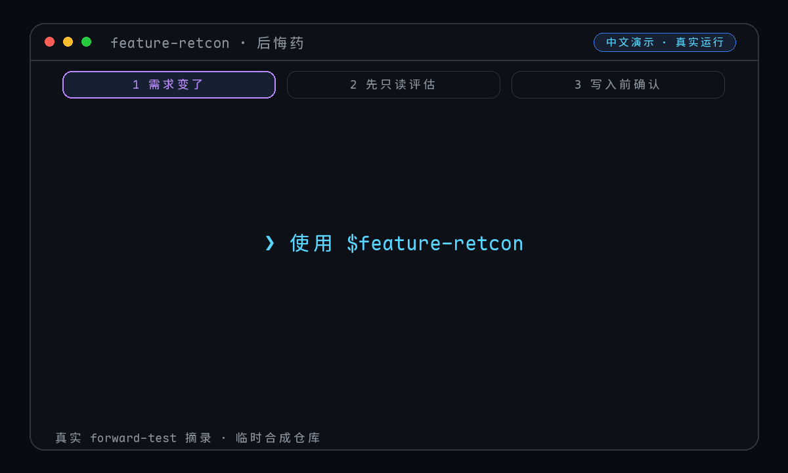
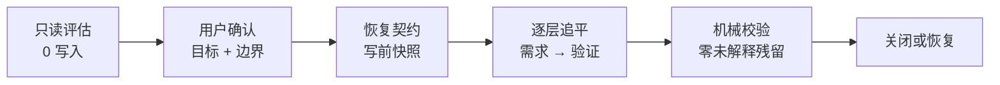

<div align="center">

# 💊 feature-retcon · 后悔药

### 功能做到一半，需求变了？别在旧答案上继续打补丁。

给 AI Coding Agent 一次**可评估、可确认、可恢复**的重写机会：把需求、设计、任务、代码和验证重新追平到同一个权威结果。

[English](README_EN.md) · [30 秒看懂](#30-秒看懂) · [黄金案例](#三个可复制的黄金案例) · [多-Agent-安装](#安装给一个或多个-agent) · [安全证据](#安全不是口号)

[](https://github.com/songzhuozhu/feature-retcon/actions/workflows/test.yml)
[](https://skills.sh/songzhuozhu/feature-retcon)
[](https://github.com/songzhuozhu/feature-retcon/stargazers)
[](https://www.python.org/)
[](LICENSE)

</div>

---

改一行需求很容易。真正危险的是：规格相信新答案，任务还在执行旧答案，代码只改了一半，测试继续证明一个已经失效的世界。

`feature-retcon` 把这类变更当成一次 **retcon（设定重写）**，而不是一次普通补丁：

- **先看清，再动手**：第一次调用严格只读，先给出影响范围、冲突、删除项、风险与推荐阶段。
- **先确认，再写入**：没有用户对目标和可写边界的明确确认，不创建文件、不改代码。
- **改的是权威态**：从需求开始逐层追平到指定阶段，不让新旧语义同时存活。
- **每一步能反悔**：文件写入前记录 SHA-256、权限和恢复来源；中断后可重试，漂移时立即停止。

## 30 秒看懂

<p align="center">
  
</p>

<p align="center"><sub>19.4 秒中文真实运行摘录；等待时间已压缩，评估数字来自案例 1。可由 <a href="scripts/render_demo.py">渲染脚本</a>重新生成（仅该脚本需要 Pillow）。</sub></p>

```text
你：请使用 feature-retcon Skill 评估这次变更：
    导出不再固定生成 PDF，改为让用户选择 PDF 或 CSV。

后悔药（只读评估）：
    权威依据   specs/export.md；Git 基线干净
    当前水位   tasks
    建议水位   requirements
    阶段陈旧   design、tasks
    预计影响   3 个文件、5 处旧结论替换、0 个文件删除
    本轮写入   0
    下一步     等待你确认断言、阶段和可写根
```

> 上面是案例 1 真实评估的压缩摘录。完整输出包含 11 个固定栏目；这里没有把未执行的确认或写入伪装成演示结果。



普通的“帮我改一下”与 `feature-retcon` 的差别：

| | 普通增量修改 | feature-retcon |
|---|---|---|
| 动手前 | 很快开始编辑 | 先只读建立影响图 |
| 写入权限 | 容易默认扩大 | 显式锁定可写工作根 |
| 新旧语义 | 常靠人工搜索 | 维护残留签名并逐项解释 |
| 中途停止 | 依赖 Git 或记忆 | 按文件记录可恢复写前状态 |
| 完成标准 | “代码看起来改完了” | 目标阶段、验证、日志链同时闭合 |

## 安装给一个或多个 Agent

`feature-retcon` 使用可移植的 `SKILL.md` 作为唯一工作流入口，不依赖 Codex 专有语法。推荐通过 [Skills CLI](https://github.com/vercel-labs/skills) 安装；同一份 Skill 可以链接到多个 Agent，后续更新只维护一个副本。

安装给一个 Agent，把 `<agent-id>` 替换为下表中的值：

```bash
npx skills add songzhuozhu/feature-retcon -g -a <agent-id>
```

一次安装给常见的七个 Coding Agent：

```bash
npx skills add songzhuozhu/feature-retcon -g \
  -a codex -a claude-code -a cursor -a opencode \
  -a gemini-cli -a github-copilot -a openclaw
```

| Agent | `agent-id` | 全局安装位置 | 当前验证状态 |
|---|---|---|---|
| Codex | `codex` | `~/.codex/skills/` | 完整 forward-test + 自动化测试 |
| Claude Code | `claude-code` | `~/.claude/skills/` | Skills CLI 实际安装通过；待独立行为 forward-test |
| Cursor | `cursor` | `~/.cursor/skills/` | Skills CLI 实际安装通过；待独立行为 forward-test |
| OpenCode | `opencode` | `~/.config/opencode/skills/` | Skills CLI 实际安装通过；待独立行为 forward-test |
| Gemini CLI | `gemini-cli` | `~/.gemini/skills/` | Skills CLI 实际安装通过；待独立行为 forward-test |
| GitHub Copilot | `github-copilot` | `~/.copilot/skills/` | Skills CLI 实际安装通过；待独立行为 forward-test |
| OpenClaw | `openclaw` | `~/.openclaw/skills/` | Skills CLI 安装 + ClawHub dry-run 通过；待独立行为 forward-test |

若安装器不支持符号链接，追加 `--copy`。若只想在当前项目内启用，去掉 `-g`。

### 两个分发渠道

| 渠道 | 用户入口 | 收录方式 |
|---|---|---|
| [skills.sh](https://skills.sh) | `npx skills add songzhuozhu/feature-retcon` | 公共 GitHub 仓库被用户通过 Skills CLI 安装后自动进入榜单 |
| [ClawHub](https://clawhub.ai) | `clawhub install @songzhuozhu/feature-retcon` | 通过仓库内的发布工作流生成独立版本；首次发布后生效 |

ClawHub 会把已发布 Skill 以 **MIT-0** 再分发。仓库的手动发布工作流因此要求显式勾选许可确认，并需要 `CLAWHUB_TOKEN`；普通 PR 只做 dry-run，不会发布。

不使用安装器时，也可以直接克隆到任一宿主的 Skill 目录。例如 Codex：

```bash
git clone https://github.com/songzhuozhu/feature-retcon ~/.codex/skills/feature-retcon
```

运行时只需要 Python 3.9+ 标准库；Git 是可选恢复来源，不是执行前提。

## 开始使用

为避免 Agent 把普通修改误判成 retcon，推荐始终显式调用。Codex 的元数据会机械禁用隐式调用；其他宿主是否自动触发由各自策略决定，但即使被触发，Skill 的第一次调用仍受**严格只读**门禁保护。

所有宿主都可以直接使用自然语言：

```text
请使用 feature-retcon Skill 对当前仓库做只读评估：<被推翻的旧行为和当前目标>
```

在支持名称调用的宿主中，也可以使用其原生语法；例如 Codex 可写 `$feature-retcon`。下面的案例统一使用自然语言，因此复制到不同 Agent 时无需改调用符号。

第一次调用只交付评估并停止，内容包括：

1. 权威根及判定证据。
2. 被推翻行为、当前目标、保持不变与明确排除。
3. 产物依赖图、工作树冲突、删除清单和副作用。
4. 各目标阶段的量化影响与一个明确推荐。
5. 等待用户确认的写入边界。

确认后，Skill 才创建权限为 `0600` 的本地 `RECONCILIATION.md`，并通过 `prepare → 修改 → applied` 协议记录每次文件变化。你可以一次追平到实现，也可以分轮只追平需求、设计或任务。

## 三个可复制的黄金案例

选择最像你当前问题的案例，复制代码块并替换其中的业务名词。三个 Prompt 不绑定宿主，且都只授权**只读评估**；看到真实影响范围后，再使用本节末尾的确认模板决定是否执行。

<details open>
<summary><strong>案例 1：功能做到任务阶段，先只改权威需求</strong></summary>

适合：方向已经改变，但你希望先把“新答案”写清楚，不急着让 Agent 同时修改代码。

```text
请使用 feature-retcon Skill 对当前仓库做只读评估。

被推翻的行为：导出任务固定生成 PDF。
当前目标：用户可以选择 PDF 或 CSV；未选择时仍默认 PDF。
保持不变：现有导出权限、异步任务机制、下载链接有效期。
明确排除：XLSX、历史导出文件迁移、导出性能优化。

这个功能已经推进到任务阶段。本轮倾向只追平到 requirements：
- 找出当前权威需求及其下游设计、任务和测试引用；
- 说明只追平需求后，哪些阶段必须标记为陈旧；
- 给出目标阶段选项、删除清单和一个明确推荐。

第一次调用严格只读。未得到我对变更断言、目标阶段和可写根的确认前，不要创建契约或修改文件。
```

你应该看到：Skill 把“当前权威答案”和“暂时陈旧的下游”分开，不会为了显得完成而擅自修改实现。

</details>

<details>
<summary><strong>案例 2：替换 API 分页契约，同时保留一轮兼容</strong></summary>

适合：变更横跨规格、接口设计、任务、实现和测试，而且旧行为不能立刻全部删除。

```text
请使用 feature-retcon Skill 对当前仓库做只读评估。

被推翻的行为：订单列表 API 使用 page/page_size，并返回 total。
当前目标：改用 cursor/limit，并返回 next_cursor；新文档和新调用方只使用游标分页。
兼容要求：旧参数继续兼容一个发布周期，但必须被隔离为兼容层并标注删除条件。
保持不变：筛选条件、created_at 降序、鉴权和单页上限。
明确排除：数据库分片、订单模型重构、无关列表接口。

本轮希望评估追平到 implementation：
- 沿 API schema、设计、任务、服务端、客户端和测试建立依赖图；
- 区分必须删除的旧权威描述与允许暂时保留的兼容证据；
- 量化修改、创建、删除项，以及迁移和验证风险；
- 给出兼容层的残留签名与下一轮删除触发条件。

第一次调用严格只读。遇到未提交修改、生成 SDK 或跨仓库写入时，先披露并等待我确认。
```

你应该看到：零未解释残留不等于机械删除所有旧词；被明确授权的兼容路径会有边界、期限和验证证据。

</details>

<details>
<summary><strong>案例 3：删除高风险能力，并保留安全撤退路径</strong></summary>

适合：要删除已实现能力，涉及数据、外部副作用或大量负向路径，最怕改到一半无法收场。

```text
请使用 feature-retcon Skill 对当前仓库做只读评估。

被推翻的行为：未登录访客可以通过公开链接访问共享内容。
当前目标：只有已登录且属于工作区的成员可以访问；新版本上线后，现有匿名链接失效。
保持不变：成员分享链接、链接有效期、访问审计记录。
预计删除：匿名令牌签发与校验、公开访问入口、相关配置、文案和负向测试。
明确排除：账号体系重构、成员权限模型重写、在评估期真实吊销线上链接。

本轮倾向追平到 validation：
- 单独列出代码/文档删除与数据迁移、线上吊销等外部副作用；
- 把外部系统调用和不可逆操作保持为未授权；
- 评估失败关闭、旧链接拒绝、审计保留和回归测试；
- 说明若执行中发现范围扩张，怎样阻塞并等待重新确认；
- 说明我停止本轮时，怎样用本地契约逆序恢复并验证前态。

第一次调用严格只读。不得调用外部系统，不得修改 Git 状态，不得提前执行吊销或迁移。
```

你应该看到：删除项、外部副作用和恢复路径被拆开确认；“停止本轮”不会被解释成 `git reset` 或粗暴覆盖工作树。

</details>

这三个案例刻意覆盖了不同答案：**部分追平、带期限的兼容、彻底删除但可恢复**。如果三类都被处理成“全仓搜索替换”，说明 Skill 没有真正理解 retcon。

### 评估后的第二轮：确认或安全停止

不要只回复“按建议改”。把评估报告里的真实值填入下面模板，才能把授权边界锁死：

```text
根据上一轮只读评估，我确认执行本轮追平：

- 变更断言：<被推翻行为、当前目标、保持不变、排除项>
- 目标阶段：<requirements | design | tasks | implementation | validation>
- 可写工作根：<逐项列出绝对路径或明确仓库根>
- 删除清单：<逐项列出；没有则写“无”>
- 冲突处置：<保留、纳入或先由我处理>
- Hook / 外部副作用：<逐项授权；未列出的全部保持禁止>
- 敏感或大文件：<逐项授权；没有则写“无”>

先创建恢复契约并复验基线，再逐层修改。任何实质范围扩张都必须停止并重新确认；不得自动暂存、提交、重置或推送 Git。
```

如果评估结果不值得继续，或执行中想撤退，复制这一段：

```text
停止本轮。先报告当前契约状态和 verify 结果；若已有写入，按契约逆序恢复并复验基线。不得使用 git reset、覆盖未登记文件或触碰未授权工作根。恢复满足关闭门槛后，再删除本轮契约。
```

三个案例已分别在隔离的合成 Git 仓库中完成独立 forward-test：

| 案例 | 真实运行结果 | 写入 |
|---|---|---:|
| PDF → PDF/CSV | 完成 11 段只读评估；量化为 3 个需求阶段文件、5 处旧结论替换 | 0 |
| offset → cursor | 发现 `client/orders.py` 的重叠未提交修改，停止并要求用户选择基线处置 | 0 |
| 删除匿名分享 | 扫出 8 个文件、25 行旧语义，并隔离 1 个不可逆生产吊销 Hook | 0 |

## 安全不是口号

仓库当前有 **32 个自动化测试**，覆盖正常路径、故障注入、跨 Agent 文档、社区健康文件和分发门禁；CI 在 Linux/macOS、Python 3.9/3.12 上运行。

| 安全承诺 | 自动化证据 |
|---|---|
| 未确认路径不能写、恢复日志不能越界 | 工作根逃逸与篡改日志测试 |
| 恢复中断后可以安全重试 | “文件已恢复、日志未落盘”故障注入 |
| 外部修改不会被静默覆盖 | SHA-256 与文件模式漂移测试 |
| 新敏感内容不能绕过阻塞直接关闭 | 敏感信号与状态机回归测试 |
| `HEAD` 移动不会改变恢复基线 | Git 引用冻结为不可变 commit SHA 测试 |
| 损坏日志不会变成未捕获异常 | 日志结构校验与安全错误测试 |
| 临时契约不会被意外提交 | `0600` 权限与 Git 索引检查 |

恢复脚本只处理已登记的常规文件，不跟随符号链接。Git 不可用时，原始字节会以 gzip + Base64 写入本地契约；**Base64 不是加密**，敏感文件必须逐文件确认。

## 清晰的边界

为了让承诺可以被证明，v0.1.0 主动限制了范围：

- Skill 核心只使用共享 `SKILL.md` 约定；`agents/openai.yaml` 仅提供 Codex 展示元数据，不是运行依赖。
- 七个列出的宿主均已通过隔离的 Skills CLI 安装测试；Codex 另有行为级 forward-test，其他宿主尚待独立行为验证。
- 恢复保证针对已登记常规文件的字节与权限，不递归快照或自动删除目录。
- 不自动初始化、暂存、提交、重置或推送 Git。
- 不自动调用外部系统；Hook、副作用和跨仓库写入都需要单独披露与确认。
- 机械校验只能证明文件与日志一致；语义完成仍必须通过阶段门槛和残留检查。

这些限制不是免责条款，而是安全模型的一部分：边界越明确，自动化越可信。

## 它是怎样组织的

```text
feature-retcon/
├── SKILL.md                     # 核心工作流与完成标准
├── agents/openai.yaml           # Codex 展示与显式调用策略
├── .clawhubignore               # ClawHub 最小运行包边界
├── .github/workflows/           # 跨平台测试 + ClawHub 安全发布门禁
├── scripts/contract.py          # 契约状态机和恢复协议
├── assets/RECONCILIATION.md     # 临时契约模板
├── references/                  # 按场景渐进加载的详细规则
└── tests/test_contract.py       # 正常路径 + 故障注入
```

`SKILL.md` 保持短而硬，只承载所有分支都需要的顺序步骤；详细规则按场景从 `references/` 加载。恢复边界和状态迁移由脚本机械执行，不依赖 Agent “记得应该怎么做”。

## 开发与测试

```bash
python3 -m unittest discover -s tests -v
python3 scripts/contract.py --help
```

项目只接受从零构造的中性测试案例。贡献前请阅读[贡献指南](CONTRIBUTING.md)，版本变化见[变更日志](CHANGELOG.md)。发现安全边界问题，请先阅读[安全策略](SECURITY.md)，并通过 [GitHub Security Advisory](https://github.com/songzhuozhu/feature-retcon/security/advisories/new) 私下报告。

如果这个 Skill 替你避免过一次“新旧需求各改一半”，欢迎点一个 ⭐，也欢迎提交能击穿安全承诺的最小复现。

## 许可证

[MIT](LICENSE) © 2026 songzhuozhu
