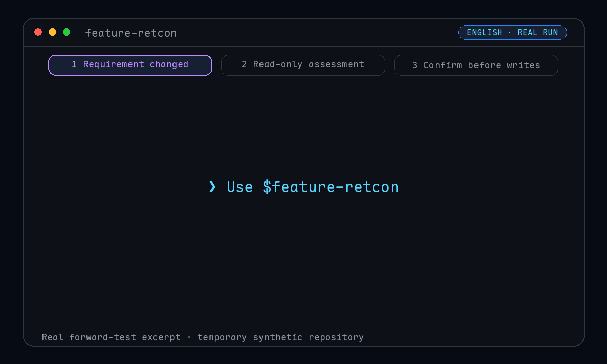
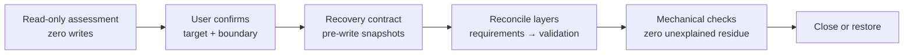

<div align="center">

# 💊 feature-retcon

### Requirements changed halfway through? Stop patching on top of an obsolete answer.

Give your AI coding agent a **reviewable, confirmable, recoverable** way to reconcile requirements, design, tasks, code, and validation to one authoritative result.

[中文优先文档](README.md) · [30-second tour](#30-second-tour) · [Golden cases](#three-copy-ready-golden-cases) · [Multi-agent install](#install-for-one-or-more-agents) · [Safety evidence](#safety-is-not-a-slogan)

[](https://github.com/songzhuozhu/feature-retcon/actions/workflows/test.yml)
[](https://skills.sh/songzhuozhu/feature-retcon)
[](https://github.com/songzhuozhu/feature-retcon/stargazers)
[](https://www.python.org/)
[](LICENSE)

</div>

---

Changing one requirement is easy. The dangerous part is leaving the spec, tasks, implementation, and tests believing different versions of the feature.

`feature-retcon` treats that change as a **retcon**, not another patch:

- **Inspect before editing.** The first invocation is strictly read-only.
- **Confirm before writing.** The user approves the target, stage, risks, and writable roots.
- **Rewrite the authority.** Artifacts are reconciled from requirements through a chosen stage.
- **Keep an exit.** Every file mutation gets a pre-write snapshot; drift stops recovery instead of overwriting it.

## 30-second tour

<p align="center">
  
</p>

<p align="center"><sub>A 19.4-second English excerpt from a real forward test. Waiting time is compressed; the numbers come from Case 1. Regenerate both localized versions with the <a href="scripts/render_demo.py">rendering script</a> (only this script requires Pillow).</sub></p>

```text
You: Use the feature-retcon skill to assess this change:
     let users choose PDF or CSV instead of always exporting PDF.

feature-retcon (read-only):
     authority    specs/export.md; clean Git baseline
     waterline    tasks → requirements
     stale        design, tasks
     impact       3 files, 5 old claims to replace, 0 file deletions
     writes       0
     next         waiting for assertions, stage, and writable roots
```

> This is a condensed excerpt from the real Case 1 assessment. The full output contains all 11 required sections; no unexecuted confirmation or mutation is presented as a demo result.



| | Ordinary incremental edit | feature-retcon |
|---|---|---|
| Before editing | Starts changing files | Builds a read-only impact graph |
| Write access | Often expands implicitly | Locks explicit writable roots |
| Old semantics | Relies on ad-hoc search | Tracks and explains residue signatures |
| Abort path | Depends on Git or memory | Records recoverable file state first |
| Done means | “The code looks changed” | Stage gates, validation, and journal all close |

## Install for one or more agents

`feature-retcon` uses a portable `SKILL.md` as its single workflow entry point and does not depend on Codex-specific invocation syntax. The recommended installer is the [Skills CLI](https://github.com/vercel-labs/skills), which can link one canonical copy to multiple agents.

For one agent, replace `<agent-id>` with a value from the table:

```bash
npx skills add songzhuozhu/feature-retcon -g -a <agent-id>
```

Install it for seven common coding agents at once:

```bash
npx skills add songzhuozhu/feature-retcon -g \
  -a codex -a claude-code -a cursor -a opencode \
  -a gemini-cli -a github-copilot -a openclaw
```

| Agent | `agent-id` | Global path | Current validation status |
|---|---|---|---|
| Codex | `codex` | `~/.codex/skills/` | Full forward test + automated suite |
| Claude Code | `claude-code` | `~/.claude/skills/` | Real Skills CLI install passed; independent behavior test pending |
| Cursor | `cursor` | `~/.cursor/skills/` | Real Skills CLI install passed; independent behavior test pending |
| OpenCode | `opencode` | `~/.config/opencode/skills/` | Real Skills CLI install passed; independent behavior test pending |
| Gemini CLI | `gemini-cli` | `~/.gemini/skills/` | Real Skills CLI install passed; independent behavior test pending |
| GitHub Copilot | `github-copilot` | `~/.copilot/skills/` | Real Skills CLI install passed; independent behavior test pending |
| OpenClaw | `openclaw` | `~/.openclaw/skills/` | Skills CLI install + ClawHub dry-run passed; independent behavior test pending |

Append `--copy` when symlinks are unavailable. Omit `-g` for a project-scoped install.

### Two distribution channels

| Channel | User entry point | How listing works |
|---|---|---|
| [skills.sh](https://skills.sh) | `npx skills add songzhuozhu/feature-retcon` | A public GitHub skill enters the leaderboard automatically after real Skills CLI installs |
| [ClawHub](https://clawhub.ai) | `clawhub install @songzhuozhu/feature-retcon` | The repository workflow publishes independent versions; available after the first release |

ClawHub redistributes published skills under **MIT-0**. The manual workflow therefore requires an explicit license confirmation and a `CLAWHUB_TOKEN`; pull requests run a dry-run only.

Without an installer, clone into any host's skill directory. For Codex:

```bash
git clone https://github.com/songzhuozhu/feature-retcon ~/.codex/skills/feature-retcon
```

Runtime requirements are Python 3.9+ and the standard library. Git is an optional recovery source.

## Start using it

Explicit invocation is recommended so an agent does not mistake an ordinary edit for a retcon. Codex metadata mechanically disables implicit invocation; other hosts apply their own activation policies. Even if activated automatically, the skill's first invocation remains behind a **strictly read-only** gate.

Natural language works across hosts:

```text
Use the feature-retcon skill to perform a read-only assessment of this repository: <old behavior and new target>
```

On hosts with named invocation, you may also use their native syntax—for example, `$feature-retcon` in Codex. The cases below use natural language so they can be pasted into different agents unchanged.

The first invocation reports authority evidence, change assertions, the artifact graph, conflicts, deletions, side effects, quantified stage options, and one recommendation—then stops. Only after confirmation does it create a local mode-`0600` `RECONCILIATION.md` and begin the `prepare → edit → applied` protocol.

## Three copy-ready golden cases

Choose the closest case, copy its block, and replace the domain terms. The prompts are host-neutral and authorize a **read-only assessment only**; use the confirmation template at the end of this section only after reviewing repository evidence.

<details open>
<summary><strong>Case 1: The feature reached tasks; reconcile requirements first</strong></summary>

```text
Use the feature-retcon skill to perform a read-only assessment of the current repository.

Superseded behavior: export jobs always generate PDF.
Current target: users may choose PDF or CSV; no selection still defaults to PDF.
Keep unchanged: export authorization, asynchronous jobs, and download-link lifetime.
Exclude: XLSX, migration of historical exports, and export performance work.

The feature has reached the tasks stage. For this round, I prefer requirements only:
- locate the authoritative requirement and downstream design, task, and test references;
- identify which downstream stages must become stale after a requirements-only retcon;
- report stage options, a deletion manifest, and one recommendation.

The first invocation is strictly read-only. Do not create a contract or edit files before I confirm the assertions, target stage, and writable roots.
```

Expected signal: the skill separates the new authority from intentionally stale downstream artifacts instead of editing implementation to look complete.

</details>

<details>
<summary><strong>Case 2: Replace an API contract with one release of compatibility</strong></summary>

```text
Use the feature-retcon skill to perform a read-only assessment of the current repository.

Superseded behavior: the orders API accepts page/page_size and returns total.
Current target: use cursor/limit and return next_cursor; new docs and callers use cursor pagination only.
Compatibility: accept the old parameters for one release in an isolated compatibility layer with explicit removal conditions.
Keep unchanged: filters, created_at descending order, authorization, and the per-page limit.
Exclude: database sharding, order-model refactoring, and unrelated list APIs.

Assess reconciliation through implementation:
- map the API schema, design, tasks, server, clients, and tests;
- distinguish obsolete authority from explicitly retained compatibility evidence;
- quantify edits, additions, deletions, migration risk, and validation;
- define residue signatures and the trigger for removing the compatibility layer.

The first invocation is strictly read-only. Disclose overlapping worktree changes, SDK generation, or cross-repository writes before asking for confirmation.
```

Expected signal: zero unexplained residue does not mean deleting every old term. Authorized compatibility has a boundary, deadline, and validation evidence.

</details>

<details>
<summary><strong>Case 3: Remove a high-risk capability with a safe abort path</strong></summary>

```text
Use the feature-retcon skill to perform a read-only assessment of the current repository.

Superseded behavior: unauthenticated visitors can access shared content through public links.
Current target: only signed-in workspace members may access it; existing anonymous links become invalid after release.
Keep unchanged: member share links, link expiry, and access audit records.
Expected deletions: anonymous-token issue/validation, the public entry point, configuration, copy, and negative-path tests.
Exclude: account-system refactoring, permission-model redesign, and revoking live links during assessment.

Assess reconciliation through validation:
- separate repository edits from data migration and live revocation side effects;
- keep external calls and irreversible operations unauthorized;
- cover fail-closed behavior, old-link rejection, audit retention, and regressions;
- explain how scope expansion blocks for renewed confirmation;
- explain how an aborted round restores and verifies the prior state from the local contract.

The first invocation is strictly read-only. Do not call external systems, modify Git state, revoke links, or run migrations.
```

Expected signal: deletions, side effects, and recovery are confirmed separately; “abort” never becomes `git reset` or a blind worktree overwrite.

</details>

The three cases intentionally require different outcomes: **partial reconciliation, time-bounded compatibility, and full removal with recovery**. Treating all three as repository-wide search-and-replace would miss the point of a retcon.

### Round two: confirm or stop safely

Do not reply with only “apply the recommendation.” Fill in the observed values from the assessment so authorization remains exact:

```text
Based on the previous read-only assessment, I confirm this reconciliation round:

- Change assertions: <superseded behavior, current target, invariants, exclusions>
- Target stage: <requirements | design | tasks | implementation | validation>
- Writable roots: <list each absolute path or explicit repository root>
- Deletion manifest: <list each item; use “none” when empty>
- Conflict handling: <preserve, include, or let me resolve first>
- Hooks / external side effects: <authorize each item; everything omitted stays forbidden>
- Sensitive or large files: <authorize each item; use “none” when empty>

Create the recovery contract and re-check the baseline before editing. Stop for renewed confirmation on any material scope expansion. Do not stage, commit, reset, or push Git automatically.
```

If the assessment is not worth executing, or you need to abort an active round, paste this:

```text
Stop this round. First report contract status and verify results. If writes exist, restore in reverse journal order and re-run the baseline. Do not use git reset, overwrite unregistered files, or touch unauthorized roots. Delete the round contract only after all close gates pass.
```

Each case was independently forward-tested in an isolated synthetic Git repository:

| Case | Observed result | Writes |
|---|---|---:|
| PDF → PDF/CSV | Completed all 11 assessment sections; quantified 3 requirements-stage files and 5 old claims to replace | 0 |
| offset → cursor | Found an overlapping uncommitted change in `client/orders.py`, stopped, and requested a baseline decision | 0 |
| remove anonymous sharing | Found 25 old-semantic lines across 8 files and isolated one irreversible production revocation hook | 0 |

## Safety is not a slogan

The repository currently has **32 automated tests** covering normal paths, fault injection, cross-agent docs, community health files, and distribution gates across Linux/macOS and Python 3.9/3.12.

| Safety claim | Automated evidence |
|---|---|
| Journal entries cannot escape writable roots | Path-escape and tampered-journal tests |
| Interrupted restoration can be retried | File-restored/journal-not-persisted fault injection |
| External edits are not silently overwritten | SHA-256 and file-mode drift tests |
| Sensitive blocks cannot jump to ready | Sensitive-signal state-machine regression |
| Moving `HEAD` cannot move the recovery baseline | Commit-SHA freezing test |
| Damaged journals fail safely | Structural validation and clean-error test |
| Recovery contracts stay local | Mode `0600` and Git index checks |

The recovery tool handles registered regular files only and never follows symlinks. Without Git, original bytes are stored locally as gzip + Base64. **Base64 is not encryption**; sensitive files require per-file confirmation.

## Deliberate boundaries

- The core package uses the shared `SKILL.md` convention only; `agents/openai.yaml` is optional Codex UI metadata, not a runtime dependency.
- All seven listed hosts passed an isolated Skills CLI installation test. Codex additionally has behavior-level forward-test evidence; the other hosts still need independent behavior validation.
- Recovery covers registered regular-file bytes and modes; it does not recursively snapshot or remove directories.
- It never initializes, stages, commits, resets, or pushes Git state.
- External systems, hooks, side effects, and cross-repository writes require separate disclosure and confirmation.
- Mechanical checks prove file/journal consistency; semantic completion still requires stage gates and residue checks.

These constraints are part of the safety model: precise boundaries make automation trustworthy.

## Development

```bash
python3 -m unittest discover -s tests -v
python3 scripts/contract.py --help
```

Only synthetic, neutral fixtures are accepted. Read the [contribution guide](CONTRIBUTING.md), review release history in the [changelog](CHANGELOG.md), and follow the [security policy](SECURITY.md) before reporting security-boundary issues privately through a [GitHub Security Advisory](https://github.com/songzhuozhu/feature-retcon/security/advisories/new).

If this skill saves you from one half-migrated requirement, consider leaving a ⭐. Better yet, contribute a minimal reproduction that breaks a safety claim.

## License

[MIT](LICENSE) © 2026 songzhuozhu
